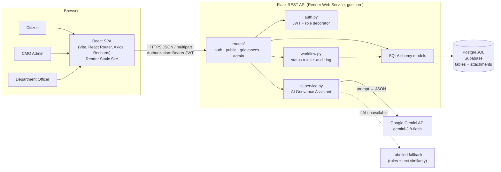

# 02 – System Architecture

## Overview
A three-tier web application: a **React single-page app** talks to a **Flask REST API** over HTTPS using JSON, and the API stores data in **PostgreSQL**. The API calls the **Google Gemini** LLM for grievance analysis.

## Architecture diagram

A standalone copy is in [diagrams/architecture.md](diagrams/architecture.md).

## Frontend (`/frontend`)
- **React 19 + Vite.** Pages are grouped by audience: `pages/public`, `pages/citizen`, `pages/cmo`, `pages/officer`.
- **Routing:** React Router. `ProtectedRoute` redirects users without the right role (for usability only; the backend enforces security).
- **State:** `AuthContext` holds the logged-in user; the JWT is stored in `localStorage`.
- **API client:** `api.js` (Axios) adds the `Authorization` header to every request and logs the user out on 401.
- **Charts:** Recharts renders `/api/stats` data (pie, bar, stacked bar, line).
- **Role-aware detail page:** `GrievanceDetail.jsx` shows different action panels for each role.

## Backend (`/backend`)
| Module | Responsibility |
|---|---|
| `app/__init__.py` | App factory: config, CORS, blueprints, JSON error handlers, security headers, table creation (local SQLite) |
| `config.py` | Reads all settings and secrets from environment variables |
| `models.py` | 9 SQLAlchemy models (see 03_Database_Design.md) |
| `auth.py` | `create_token()` and the `@login_required(*roles)` decorator |
| `workflow.py` | Allowed status transitions per role, `log_action()` that writes history, `can_view()` ownership rules |
| `ai_service.py` | Duplicate candidates, Gemini call (tries each model in `GEMINI_MODEL` in order), output validation, labelled fallback |
| `routes/auth_routes.py` | Register, login, me, logout |
| `routes/public_routes.py` | Health, meta lists, departments, contact, public tracking, public stats |
| `routes/grievance_routes.py` | Submit, list, detail, status, edit, assign, remarks, escalate, re-analyse, ATR submit/review, feedback, file download |
| `routes/admin_routes.py` | Statistics, AI analyse, officers list and creation, contact enquiries |
| `validators.py` | Name/email/mobile/password checks shared by registration and officer creation |
| `cli.py` | `load-reference-data` and `create-cmo` commands (no automatic seeding) |

### Request lifecycle (example: officer updates status)
1. React calls `PATCH /api/grievances/12/status` with the JWT.
2. `@login_required()` decodes the token and loads the user from the DB (401 if invalid).
3. `can_view()` checks that the grievance belongs to the officer's department (404 if not).
4. `can_transition("officer", "Under Review", "In Progress")` checks the workflow rules (409 if not allowed).
5. `log_action()` changes the status and inserts a `grievance_history` row with user, remark and timestamp.
6. The transaction is committed and the updated record is returned as JSON.

## Database
PostgreSQL on Supabase in production (connected through the session pooler). SQLite is used for local development and the in-memory test suite. SQLAlchemy keeps the code identical for both. On Supabase the schema is created by `supabase/schema.sql` (with row level security enabled, so the public API key cannot read the tables). Locally, SQLAlchemy creates the tables on start-up. Nothing is seeded automatically.

## APIs
REST over JSON (multipart for file uploads). See [04_API_Documentation.md](04_API_Documentation.md).

## AI architecture
`ai_service.analyze_grievance()` is used in three places: the live preview on the submit form (`POST /api/ai/analyze`), automatic analysis stored at submission, and the CMO's "Re-run AI" button. See [05_AI_Integration.md](05_AI_Integration.md).

## Security design
- Passwords hashed with Werkzeug (PBKDF2/scrypt). Plain passwords are never stored.
- JWT signed with `SECRET_KEY` (HS256), 12-hour expiry.
- Role checks on every protected endpoint; ownership checks (citizen = own, officer = own department).
- The same 404 for "not found" and "not yours", so other users' IDs cannot be probed.
- Public registration creates **citizens only**. The first CMO is created from the command line; the CMO then creates officer accounts (`POST /api/officers`).
- Row level security is enabled on every Supabase table; only the backend (database owner role) can access data.
- Upload validation: extension allow-list, magic-byte content check, 5 MB limit, `secure_filename`.
- Internal remarks are filtered out of citizen and public responses.
- Security headers (`nosniff`, `X-Frame-Options: DENY`, referrer policy); CORS restricted to the frontend origin.
- Secrets only in environment variables; `.env` is git-ignored and `.env.example` has placeholders.
- SQLAlchemy parameterised queries prevent SQL injection; React escapes output, preventing XSS.

## Deployment
```
GitHub repo ──► Render Blueprint (render.yaml)
                 ├─ cmk-grievance-api   (Python, gunicorn)  ──► Supabase PostgreSQL
                 │                                          └─► Gemini API
                 └─ cmk-grievance-portal (static React build, SPA rewrite)
```
