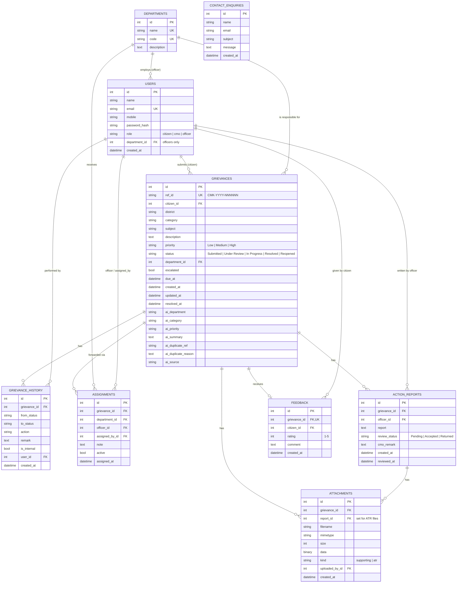

# 03 – Database Design

PostgreSQL (Supabase) in production, SQLite locally. The ORM models are in `backend/app/models.py`. The Supabase schema is the SQL in [`supabase/schema.sql`](../supabase/schema.sql) (tables, foreign keys, CHECK constraints, indexes, row level security). Locally SQLAlchemy creates the same tables on start-up.

## ER diagram

A standalone copy is in [diagrams/er_diagram.md](diagrams/er_diagram.md).

## Tables
| Table | Purpose | Key points |
|---|---|---|
| `users` | Citizens, CMO admins and officers in one table | `role` column; `department_id` only for officers; unique email; hashed password |
| `departments` | Government departments (fictional sample) | Unique `name` and `code` (PWD, KWA, KSEB …) |
| `grievances` | The complaint | Unique `ref_id`; official `priority/category/department` stored **separately** from `ai_*` suggestions so human decisions and AI output are never mixed |
| `grievance_history` | Audit trail | One row per action: from/to status, remark, user, timestamp, `is_internal` |
| `assignments` | Forwarding records | Every forward is kept; `active` marks the current one, so re-assignments are traceable |
| `attachments` | Uploaded files | Bytes stored in the DB (persist on free hosting, protected by access checks); `kind` separates citizen evidence from ATR files |
| `action_reports` | Officer's action-taken report | CMO review result and remark |
| `feedback` | Citizen rating after resolution | One per grievance (unique FK) |
| `contact_enquiries` | Contact Us form | Public submissions, visible to the CMO |

## Relationships
- A **citizen** has many grievances; a grievance belongs to one citizen.
- A **department** has many officers and many grievances.
- A grievance has many **history** rows, **assignments**, **attachments** and **action reports**, and at most one **feedback**.
- An action report can have attachments (`attachments.report_id`).
- Deleting a grievance cascades to its child rows (configured in SQLAlchemy).

## Design decisions
- **Relational model.** Workflow data is strongly connected (user ↔ grievance ↔ department ↔ history), so foreign keys and transactions keep it consistent.
- **Single users table with roles.** Simple authentication; officer-only data is a nullable FK.
- **History as an append-only log.** Status changes are never overwritten, so the full lifecycle can be traced (a mandatory requirement).
- **Overdue is computed, not stored:** `status != Resolved AND now > due_at`. `due_at` = created + 3/7/14 days (High/Medium/Low), reset on reopen.
- **Indexes** on `users.email`, `grievances.ref_id`, `grievances.status` and `grievance_history.grievance_id` for frequent lookups.
- **Reference number** `CMK-<year>-<id padded to 6>` is unique and generated after insert.

## Sample data
Plain SQL files in `supabase/`, run on purpose and never automatically:
- `reference_data.sql`: the 11 departments (fictional).
- `demo_accounts.sql`: **test accounts only** for evaluators: 1 CMO, 11 officers (one per department) and 2 citizens, all with password `Demo@1234` stored as a scrypt hash. Skip this file on a real deployment and use `python -m app.cli create-cmo`.

- `sample_grievances.sql` (optional, Supabase/PostgreSQL): 22 fictional grievances in every status, each with its history, plus assignments, action-taken reports, feedback, one escalation, one duplicate pair and 2 contact enquiries, so the dashboards and charts have data. It needs the two files above first and does nothing if run twice. Sample records are labelled `sample data (not AI)` in `ai_source`.
